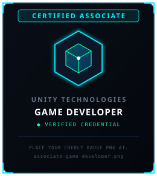

# 🛠️ REVA BHAVSAR — PROFILE ASSET & CONFIGURATION MANUAL

> **COMMAND CENTER ASSET ARCHITECTURE**  
> This guide details all visual assets, directory structures, credential badge workflows, and GitHub Actions automation configured for the `@revabhavsar` GitHub profile.

---

## 📁 1. ASSET DIRECTORY STRUCTURE

The repository is organized cleanly with self-contained, high-performance vector graphics and verified project captures:

```text
revabhavsar/
├── .github/
│   └── workflows/
│       └── snake.yml             # Automated GitHub contribution grid snake generator
├── assets/
│   ├── avatar.png                # Futuristic gamer/developer avatar
│   ├── banner.svg                # Custom Cyberpunk HUD hero header
│   ├── terminal.svg              # Animated CSS developer console boot sequence
│   ├── github-contribution-grid-snake.svg # Contribution visual (auto-updated by Actions)
│   ├── hud/
│   │   ├── divider-cyan.svg      # Electric Cyan & Emerald HUD section divider
│   │   └── divider-purple.svg    # Neon Violet & Magenta HUD section divider
│   ├── projects/
│   │   ├── soullink-ar.jpg       # SoulLink AR project capture
│   │   ├── nature-terrain.jpg    # Cinematic Nature Terrain (HDRP) capture
│   │   ├── vr-accident.jpg       # VR Accident Investigation simulation capture
│   │   ├── dont-look-down.jpg    # Don't Look Down Snap Lens runner capture
│   │   ├── dont-look-down-banner.jpg # Don't Look Down official widescreen banner
│   │   └── gaming-room.jpg       # Dream Gaming Room Blender 3D render
│   └── unity-badges/
│       ├── associate-game-developer.svg     # Unity Certified Associate: Game Developer card
│       ├── associate-programmer.svg         # Unity Certified Associate: Programmer card
│       ├── pathway-essentials.svg           # Unity Essentials pathway card
│       ├── pathway-junior-programmer.svg    # Unity Junior Programmer pathway card
│       ├── pathway-mobile-ar.svg            # Unity Mobile AR Development pathway card
│       └── pathway-vr-development.svg       # Unity VR Development pathway card
├── README-ASSET-GUIDE.md         # This comprehensive documentation guide
└── README.md                     # Main profile command center README
```

---

## 🎖️ 2. UNITY CREDENTIALS & BADGE WORKFLOW

Your profile features **two credential categories**:
1. **Official Certified Associate Credentials** (Professional industry certifications)
2. **Unity Learning Pathway Badges** (Specialized learning milestone achievements)

### Current State
We have generated crisp, futuristic SVG badge cards in `assets/unity-badges/` designed to match your cyberpunk HUD aesthetic without altering or fabricating official Unity artwork.

### How to Upgrade to Official Credly / Unity PNG Badges
If you want to display your exact Credly or Unity certification badge exports:
1. Export your official PNG badge images from your **Credly** or **Unity Learn** profile.
2. Save them into `assets/unity-badges/` using the following exact filenames:
   - `associate-game-developer.png`
   - `associate-programmer.png`
   - `pathway-essentials.png`
   - `pathway-junior-programmer.png`
   - `pathway-mobile-ar.png`
   - `pathway-vr-development.png`
3. In `README.md`, simply switch the image extension in the respective `` tag from `.svg` to `.png`:
   ```html
   <!-- Before: -->
   

   <!-- After: -->
   
   ```
4. If you have public verification URLs (e.g., `https://www.credly.com/badges/...`), wrap the image in an `<a>` tag:
   ```html
   <a href="https://www.credly.com/badges/YOUR-VERIFICATION-ID" target="_blank">
     
   </a>
   ```

---

## 🐍 3. GITHUB CONTRIBUTION SNAKE AUTOMATION

The contribution snake visual is driven by `.github/workflows/snake.yml` using `Platane/snk@v3`.

### Prerequisites for GitHub Actions:
To ensure the automated snake workflow can commit updates back to your repository:
1. Go to your repository on GitHub: `https://github.com/revabhavsar/revabhavsar`
2. Click **Settings** (top navigation tab).
3. In the left sidebar, click **Actions** → **General**.
4. Scroll down to **Workflow permissions**.
5. Select **"Read and write permissions"** and check **"Allow GitHub Actions to create and approve pull requests"**.
6. Click **Save**.

### Manual Trigger:
1. Go to the **Actions** tab on your GitHub repository.
2. In the left workflow list, select **"Generate Contribution Snake"**.
3. Click the **"Run workflow"** button on the right and select the `main` branch.
4. Once completed, your live contribution grid snake will render automatically in the profile.
5. In addition to manual runs, the workflow executes on a daily cron schedule at `00:00 UTC`.

---

## 🎮 4. PROJECT CAPTURES & DEMO LINKS

All project thumbnails in `assets/projects/` are real assets harvested directly from your portfolio and repositories:

| Project | Asset Path | Verified Repository / Demo |
| :--- | :--- | :--- |
| **SoulLink AR** | `assets/projects/soullink-ar.jpg` | [GitHub Repo](https://github.com/revabhavsar/-SoulLink-AR-The-Mentorship-Bridge) |
| **VR Accident Investigation** | `assets/projects/vr-accident.jpg` | [GitHub Repo](https://github.com/revabhavsar/VR-Accident-Investigation) • [YouTube Demo](https://youtu.be/zs-0zS-wrrQ) |
| **Don't Look Down** | `assets/projects/dont-look-down.jpg` | [GitHub Repo](https://github.com/revabhavsar/Dont_look_down) • [YouTube Gameplay](https://youtube.com/shorts/1S56-MQhRFM?si=1AYlyi-d49YXXmzx) |
| **Cinematic Nature Terrain** | `assets/projects/nature-terrain.jpg` | [GitHub Repo](https://github.com/revabhavsar/Nature__Terrain) |
| **Dream Gaming Room** | `assets/projects/gaming-room.jpg` | [GitHub Repo](https://github.com/revabhavsar/Gaming-Room---Blender) |

To add or update project screenshots:
- Place a 16:9 or 4:3 screenshot (`.jpg` or `.png`) into `assets/projects/`.
- Optimize the image using tools like TinyPNG or Squoosh to keep file size under 300 KB for optimal GitHub loading speeds.

---

## ⚡ 5. VECTOR ASSETS (BANNER, TERMINAL, HUD)

- **`assets/banner.svg`**: Responsive vector banner (1000x400 viewBox) featuring tech coordinate overlays, glowing isometric Unity cubes, robotics axes, and your credentials strip.
- **`assets/terminal.svg`**: Animated developer console simulation displaying your `REVA_OS` startup sequence with staggered CSS `@keyframes` transitions, CRT scanlines, and blinking block cursor.
- **`assets/hud/divider-cyan.svg` & `divider-purple.svg`**: Lightweight HUD separator bars with precision tech brackets and glowing gradients.

All vector assets are written in pure SVG and contain self-contained CSS styles compatible with GitHub's image rendering sandbox.
