<div align="center">

<!-- HERO BANNER -->
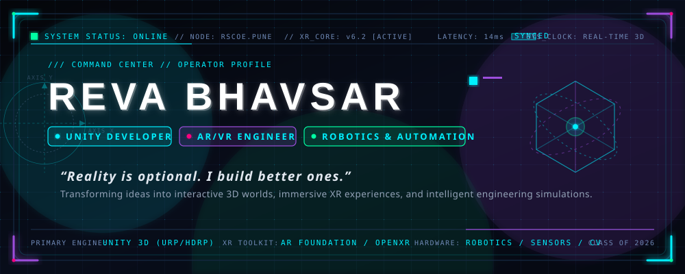

<br/>

<!-- ANIMATED TYPING HEADLINE -->
<a href="https://reva-bhavsar.lovable.app">
  
</a>

<p align="center">
  <code>SYSTEM STATUS: ONLINE</code> &nbsp;•&nbsp;
  <code>PRIMARY MODE: XR DEV</code> &nbsp;•&nbsp;
  <code>ENGINE: UNITY 3D</code> &nbsp;•&nbsp;
  <code>PUNE, IN</code>
</p>

<!-- ACTION COCKPIT BUTTONS -->
<p align="center">
  <a href="https://reva-bhavsar.lovable.app">
    
  </a>
  &nbsp;
  <a href="https://www.linkedin.com/in/reva-bhavsar-500705234/">
    
  </a>
  &nbsp;
  <a href="#-project-lab--worlds-i-build">
    
  </a>
  &nbsp;
  <a href="mailto:revabhavsar458@gmail.com">
    
  </a>
</p>


</div>

<br/>

<!-- ========================================== -->
<!-- 01. ANIMATED DEVELOPER CONSOLE -->
<!-- ========================================== -->

## ⚡ REVA_OS // COMMAND TERMINAL

<div align="center">
  
</div>

<details>
<summary>📟 <i>Click to inspect raw console output (Accessible Fallback)</i></summary>

```text
REVA_OS // XR DEVELOPMENT ENVIRONMENT
--------------------------------------
> initializing_unity_engine ......................... [ OK ]
> loading_spatial_computing_modules .................. [ OK ]
> initializing_ar_vr_systems ......................... [ OK ]
> loading_robotics_toolkit ........................... [ OK ]
> compiling_interactive_worlds ....................... [ OK ]
> rendering_immersive_experiences .................... [ OK ]

[ SYSTEM ONLINE // READY FOR SIMULATION ]

IDENTITY : REVA BHAVSAR
ROLE     : UNITY XR DEVELOPER
SPECIALTY: AR / VR / ROBOTICS / 3D SIMULATION
STATUS   : BUILDING THE FUTURE
```
</details>

<br/>

<div align="center">
  
</div>

<br/>

<!-- ========================================== -->
<!-- 02. ABOUT ME -->
<!-- ========================================== -->

## 🌐 ARCHITECTURAL OVERVIEW // ABOUT ME

<table>
  <tr>
    <td width="65%" valign="top">
      <p>
        I am a <b>Unity Game Developer and XR Engineer</b> bridging the physical precision of <b>Robotics &amp; Automation</b> with the infinite possibilities of <b>Spatial Computing</b>.
      </p>
      <p>
        My technical journey began with a <b>Diploma in Computer Engineering</b> from <i>R.C. Patel Polytechnic</i>, establishing my bedrock in object-oriented programming, data architecture, and software systems. Currently pursuing my <b>B.Tech in Automation &amp; Robotics at JSPM's Rajarshi Shahu College of Engineering, Pune (Class of 2026)</b>, I channel kinematic principles, sensor integration, and real-time computation directly into interactive 3D simulations.
      </p>
      <p>
        Whether developing <b>AI-driven AR mentorship avatars</b>, architecting <b>VR industrial accident forensics</b>, or staging atmospheric <b>HDRP biomes and Blender environments</b>, my engineering philosophy remains constant:
      </p>
      <p>
        <b><i>“Reality is optional. I build better ones.”</i></b>
      </p>
      <p>
        Currently contributing to cutting-edge virtual reality development as an <b>XR Intern at FireBird VR</b>, while exploring real-time graphics optimization, OpenXR integrations, and robotics teleoperation.
      </p>
    </td>
    <td width="35%" align="center" valign="middle">
      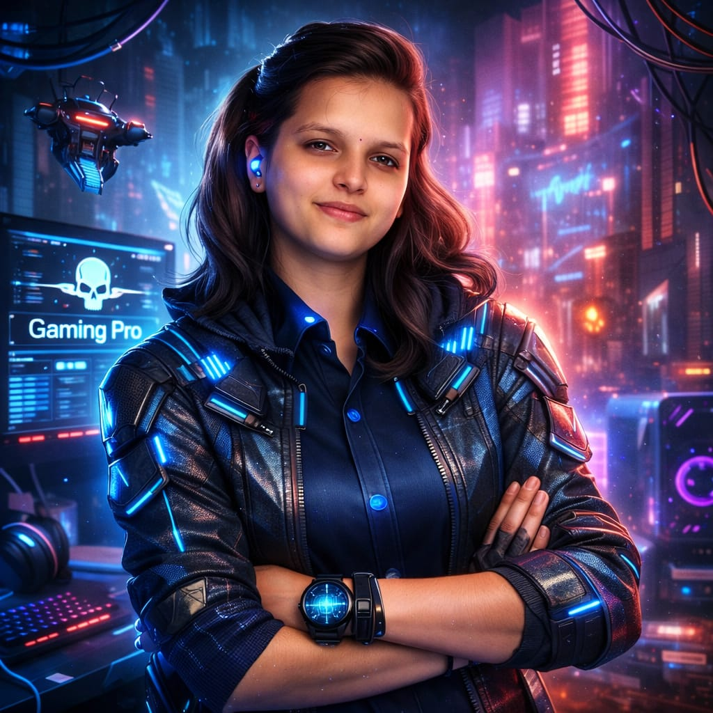
      <br/><br/>
      <p align="center">
        <code>NODE: REVA_BHAVSAR</code><br/>
        <small><code>LOCATION: PUNE, MAHARASHTRA, IN</code></small><br/>
        <small><code>CLASS: 2026 // RSCOE PUNE</code></small>
      </p>
    </td>
  </tr>
</table>

<br/>

<div align="center">
  
</div>

<br/>

<!-- ========================================== -->
<!-- 03. SPECIALIZATION & TECH STACK -->
<!-- ========================================== -->

## 🔮 MY WORLD: IMMERSIVE TECHNOLOGY + INTELLIGENT ENGINEERING

<table width="100%">
  <tr>
    <!-- A. UNITY & GAME DEV -->
    <td width="50%" valign="top">
      <h4>🎮 A. UNITY &amp; GAME DEVELOPMENT</h4>
      <p>Architecting interactive gameplay mechanics, physics dynamics, and high-fidelity rendering pipelines.</p>
      <p>
        
        
        
      </p>
      <ul>
        <li><b>Pipelines:</b> Universal Render Pipeline (URP) &amp; High Definition Render Pipeline (HDRP)</li>
        <li><b>Gameplay Engineering:</b> Character controllers, state machines, event-driven architectures</li>
        <li><b>Physics &amp; Collision:</b> 2D/3D physics simulation, raycasting, dynamic triggers</li>
        <li><b>3D Art &amp; Staging:</b> Blender modeling, terrain systems, PBR shaders, volumetric lighting</li>
      </ul>
    </td>
    <!-- B. XR (HIGHLIGHTED) -->
    <td width="50%" valign="top" style="border-left: 2px solid #00F0FF;">
      <h4>🥽 B. AUGMENTED, VIRTUAL &amp; MIXED REALITY (XR)</h4>
      <p><b>Primary Focus:</b> Building intuitive spatial interactions and multi-sensory immersion.</p>
      <p>
        
        
        
      </p>
      <ul>
        <li><b>Spatial Frameworks:</b> Unity AR Foundation, ARCore, ARKit, OpenXR</li>
        <li><b>Interaction Design:</b> XR Interaction Toolkit, hand-tracking, direct manipulation</li>
        <li><b>Spatial UI:</b> World-space canvas systems, diegetic HUDs, TextMeshPro</li>
        <li><b>Avatar &amp; AI:</b> Ready Player Me avatar pipelines, voice mentor integrations</li>
      </ul>
    </td>
  </tr>
  <tr>
    <!-- C. ROBOTICS & AUTOMATION -->
    <td width="50%" valign="top">
      <h4>🤖 C. ROBOTICS &amp; AUTOMATION</h4>
      <p>Bridging physical engineering with algorithmic control and sensor simulation.</p>
      <p>
        
        
        
      </p>
      <ul>
        <li><b>Hardware Core:</b> Arduino, ESP32, Raspberry Pi, Embedded C</li>
        <li><b>Sensors &amp; Actuation:</b> IMU telemetry, ultrasonic, motor drivers, servo kinematics</li>
        <li><b>Industrial Automation:</b> PLC fundamentals, industrial workflows, telemetry capture</li>
        <li><b>Perception &amp; Simulation:</b> Computer vision via Python, OpenCV, digital twins</li>
      </ul>
    </td>
    <!-- D. DEVELOPMENT TOOLS -->
    <td width="50%" valign="top">
      <h4>🛠️ D. DEVELOPMENT TOOLS &amp; ECOSYSTEM</h4>
      <p>Production tools supporting robust revision control and cross-platform builds.</p>
      <p>
        
        
        
      </p>
      <ul>
        <li><b>Languages:</b> C#, C++, Python, TypeScript, Embedded C, SQL</li>
        <li><b>Creative Tools:</b> Blender 3D, Unity Hub, Snap Lens Studio</li>
        <li><b>Data &amp; APIs:</b> REST APIs, JSON data serialization, WebGL templates</li>
        <li><b>Version Control:</b> Git CLI, GitHub branching &amp; automated Actions workflows</li>
      </ul>
    </td>
  </tr>
</table>

<br/>

<div align="center">
  
</div>

<br/>

<!-- ========================================== -->
<!-- 04. UNITY CREDENTIALS -->
<!-- ========================================== -->

## 🎖️ UNITY CREDENTIALS // VERIFIED PROGRESS

<p>
Official credentials and learning pathway milestones validated through <b>Unity Technologies</b>, demonstrating verified competency in real-time 3D game architecture, C# programming systems, and spatial computing.
</p>

> [!NOTE]
> **Credential Presentation Notice:** The cards below serve as temporary HUD placeholder slots until genuine badge image exports from Credly/Unity Learn are dropped into `assets/unity-badges/`. See [`README-ASSET-GUIDE.md`](README-ASSET-GUIDE.md) for easy replacement instructions.

### 🔹 Official Certified Associate Credentials
<div align="center">
  <table width="100%">
    <tr>
      <td align="center" width="50%" valign="top">
        
        <br/>
        <b>Unity Certified Associate</b><br/>
        <code>GAME DEVELOPER</code><br/>
        <small><i>Issuer: Unity Technologies • Level: Associate</i></small><br/>
        <small><code>[ HUD PLACEHOLDER SLOT — AWAITING CREDLY PNG ]</code></small>
      </td>
      <td align="center" width="50%" valign="top">
        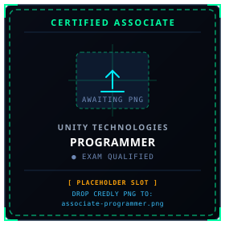
        <br/>
        <b>Unity Certified Associate</b><br/>
        <code>PROGRAMMER</code><br/>
        <small><i>Issuer: Unity Technologies • Level: Associate</i></small><br/>
        <small><code>[ HUD PLACEHOLDER SLOT — AWAITING CREDLY PNG ]</code></small>
      </td>
    </tr>
  </table>
</div>

<br/>

### 🔸 Unity Learning Pathway Milestones
<div align="center">
  <table width="100%">
    <tr>
      <td align="center" width="25%" valign="top">
        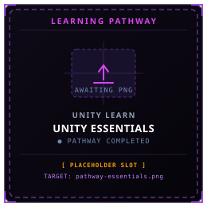<br/>
        <b>Unity Essentials</b><br/>
        <small><code>FOUNDATIONS</code></small><br/>
        <small><code>[ PLACEHOLDER SLOT ]</code></small>
      </td>
      <td align="center" width="25%" valign="top">
        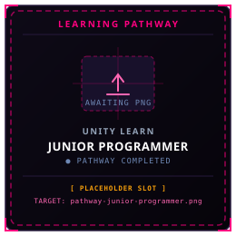<br/>
        <b>Junior Programmer</b><br/>
        <small><code>SYSTEMS &amp; LOGIC</code></small><br/>
        <small><code>[ PLACEHOLDER SLOT ]</code></small>
      </td>
      <td align="center" width="25%" valign="top">
        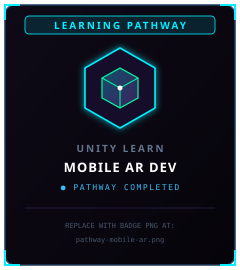<br/>
        <b>Mobile AR Dev</b><br/>
        <small><code>SPATIAL ANCHORS</code></small><br/>
        <small><code>[ PLACEHOLDER SLOT ]</code></small>
      </td>
      <td align="center" width="25%" valign="top">
        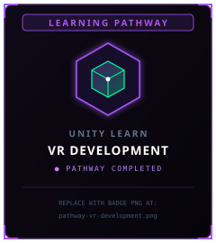<br/>
        <b>VR Development</b><br/>
        <small><code>XR TOOLKIT &amp; HEADSETS</code></small><br/>
        <small><code>[ PLACEHOLDER SLOT ]</code></small>
      </td>
    </tr>
  </table>
</div>

<br/>

#### 📋 Verified Credential Specifications
| Credential Name | Credential Type | Issuing Authority | Core Competencies Validated |
| :--- | :--- | :--- | :--- |
| **Unity Certified Associate: Game Developer** | Professional Certification | Unity Technologies | 2D/3D Game Mechanics, Scene &amp; Level Staging, Asset Integration, UI |
| **Unity Certified Associate: Programmer** | Professional Certification | Unity Technologies | C# OOP, Logic Systems, Debugging, Physics, Math for 3D Games |
| **Unity Essentials Pathway** | Learning Pathway | Unity Learn | Engine Architecture, Editor Navigation, Real-Time 3D Principles |
| **Junior Programmer Pathway** | Learning Pathway | Unity Learn | Scripting Architecture, Events, State Machines, Systems Design |
| **Mobile AR Development Pathway** | Learning Pathway | Unity Learn | AR Foundation, Plane Detection, Camera Tracking, Spatial Anchoring |
| **VR Development Pathway** | Learning Pathway | Unity Learn | XR Interaction Toolkit, OpenXR, Controller &amp; Hand Input, Locomotion |

<br/>

<div align="center">
  
</div>

<br/>

<!-- ========================================== -->
<!-- 05. FEATURED PROJECTS -->
<!-- ========================================== -->

## 🚀 PROJECT LAB // WORLDS I BUILD

### 1. SoulLink AR — The Mentorship Bridge
> **Augmented Reality • AI NPC Integration • Spatial Plane Detection • Real-Time Voice Interaction**

<table>
  <tr>
    <td width="42%" valign="middle" align="center">
      <a href="https://github.com/revabhavsar/-SoulLink-AR-The-Mentorship-Bridge">
        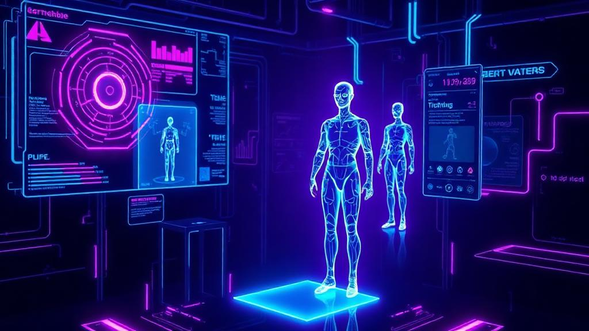
      </a>
    </td>
    <td width="58%" valign="top">
      <p>
        <b>SoulLink AR</b> is an intelligent augmented reality mentorship platform that summons AI-driven 3D avatars directly onto physical real-world surfaces for interactive guidance and learning.
      </p>
      <ul>
        <li><b>Real-World Plane Detection:</b> Powered by Unity AR Foundation to anchor avatars to desks and floors with precise physical scaling.</li>
        <li><b>Ready Player Me Integration:</b> Dynamically loads and animates expressive humanoid avatars.</li>
        <li><b>Voice &amp; AI Intelligence:</b> Integrates REST APIs and voice-recognition logic (<code>AndroidVoiceMentor</code>) for real-time natural conversation.</li>
        <li><b>Emergency / Feedback Logic:</b> Responsive UI states handling lost tracking and immediate session transitions.</li>
      </ul>
      <p>
        
        
        
        
      </p>
      <p>
        <a href="https://github.com/revabhavsar/-SoulLink-AR-The-Mentorship-Bridge"><b>🔗 View Repository on GitHub →</b></a>
      </p>
    </td>
  </tr>
</table>

---

### 2. VR Industrial Accident Investigation Simulation
> **Virtual Reality • XR Interaction Toolkit • Forensic Investigation • Industrial Training**

<table>
  <tr>
    <td width="42%" valign="middle" align="center">
      <a href="https://github.com/revabhavsar/VR-Accident-Investigation">
        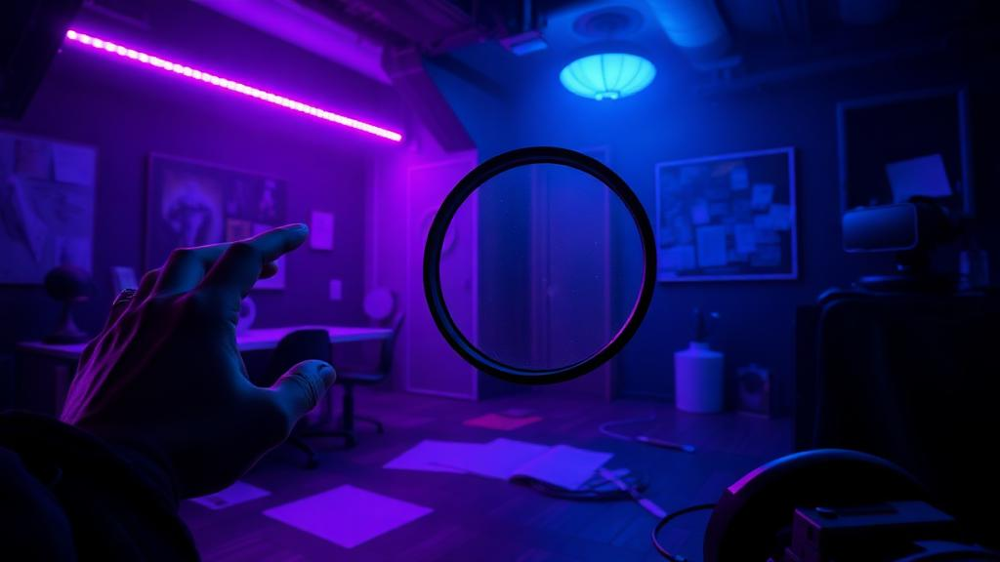
      </a>
      <br/>
      <a href="https://youtu.be/zs-0zS-wrrQ">
        
      </a>
    </td>
    <td width="58%" valign="top">
      <p>
        An immersive <b>Virtual Reality training and forensic investigation system</b> built in Unity with the XR Interaction Toolkit. The user enters an industrial warehouse, discovers clues, analyzes evidence, and evaluates root causes.
      </p>
      <ul>
        <li><b>Immersive VR Mechanics:</b> Six-degree-of-freedom hand tracking with object pickup, inspection, and hover highlights.</li>
        <li><b>Clue &amp; Evidence Engine:</b> Tracks collected investigation points dynamically with real-time HUD updates.</li>
        <li><b>Decision Panel &amp; Consequence Logic:</b> World-space UI where investigators submit causal findings with instant branching feedback.</li>
        <li><b>Sensory Feedback:</b> Spatial audio triggers and highlight shaders indicating interactable evidence.</li>
      </ul>
      <p>
        
        
        
        
      </p>
      <p>
        <a href="https://github.com/revabhavsar/VR-Accident-Investigation"><b>🔗 View Repository on GitHub →</b></a> &nbsp;|&nbsp;
        <a href="https://youtu.be/zs-0zS-wrrQ"><b>🎥 Watch YouTube VR Demo →</b></a>
      </p>
    </td>
  </tr>
</table>

---

### 3. Don't Look Down — 3D Platform Runner
> **Snap Lens Studio • TypeScript • Mobile-First 3D • Physics &amp; Precision Balancing**

<table>
  <tr>
    <td width="42%" valign="middle" align="center">
      <a href="https://github.com/revabhavsar/Dont_look_down">
        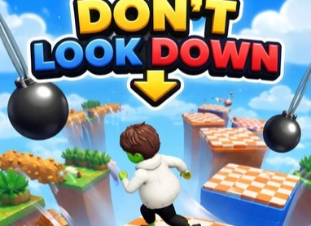
      </a>
      <br/>
      <a href="https://youtube.com/shorts/1S56-MQhRFM?si=1AYlyi-d49YXXmzx">
        
      </a>
    </td>
    <td width="58%" valign="top">
      <p>
        A fast-paced 3D platform runner built for **Snapchat's Play Everywhere ecosystem**, inspired by high-stakes obstacle challenges like <i>Takeshi's Castle</i>.
      </p>
      <ul>
        <li><b>Precision Platforming:</b> Custom character movement and jump arcs across precarious floating bridges.</li>
        <li><b>Dynamic Third-Person Camera:</b> Tension-inducing perspective that emphasizes heights and sudden drops.</li>
        <li><b>Timing &amp; Scoring Engine:</b> Calculates exact completion velocity (<code>t<sub>finish</sub> - t<sub>start</sub></code>) with instantaneous retry loops.</li>
        <li><b>Bitmoji Integration:</b> Renders personalized avatars directly into real-time 3D competitive gameplay.</li>
      </ul>
      <p>
        
        
        
      </p>
      <p>
        <a href="https://github.com/revabhavsar/Dont_look_down"><b>🔗 View Repository on GitHub →</b></a> &nbsp;|&nbsp;
        <a href="https://youtube.com/shorts/1S56-MQhRFM?si=1AYlyi-d49YXXmzx"><b>🎥 Watch YouTube Shorts Gameplay →</b></a>
      </p>
    </td>
  </tr>
</table>

---

### 4. Cinematic Nature Terrain
> **Unity HDRP • Terrain Tools • Volumetric Lighting • Environmental Art**

<table>
  <tr>
    <td width="42%" valign="middle" align="center">
      <a href="https://github.com/revabhavsar/Nature__Terrain">
        
      </a>
    </td>
    <td width="58%" valign="top">
      <p>
        A realistic outdoor environment crafted inside **Unity's High Definition Render Pipeline (HDRP)**, pushing the boundaries of real-time botanical rendering and atmospheric staging.
      </p>
      <ul>
        <li><b>Sculpted Terrain:</b> Multi-layer heightmaps, rock displacement, and biome-specific foliage placement.</li>
        <li><b>Cinematic Lighting:</b> Physical sky simulation, volumetric fog, dynamic contact shadows, and ambient occlusion.</li>
        <li><b>Performance Optimization:</b> LOD clusters, occlusion culling, and efficient texture streaming for steady framerates.</li>
      </ul>
      <p>
        
        
        
      </p>
      <p>
        <a href="https://github.com/revabhavsar/Nature__Terrain"><b>🔗 View Repository on GitHub →</b></a>
      </p>
    </td>
  </tr>
</table>

---

### 5. Dream Gaming Room — Blender 3D
> **Hard-Surface Modeling • PBR Materials • Cyberpunk Workstation • Interior Staging**

<table>
  <tr>
    <td width="42%" valign="middle" align="center">
      <a href="https://github.com/revabhavsar/Gaming-Room---Blender">
        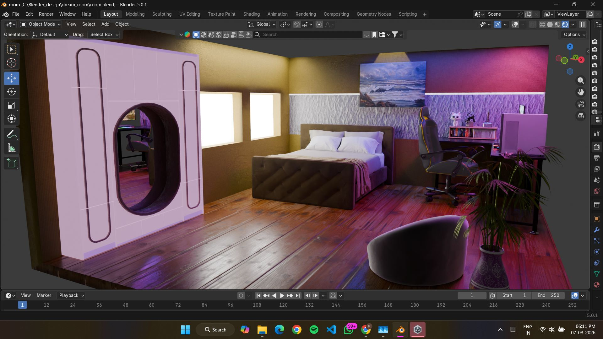
      </a>
    </td>
    <td width="58%" valign="top">
      <p>
        A high-detail 3D environment modeled and staged in Blender, capturing the ultimate cyberpunk developer and gamer command center.
      </p>
      <ul>
        <li><b>Hard-Surface Modeling:</b> Custom PC battle-station chassis, multi-monitor ergonomics, mechanical peripherals.</li>
        <li><b>Lighting &amp; Materials:</b> Balanced emissive neon LED tubes, textured wood grain, diffuse plastics, and metallic surfaces.</li>
        <li><b>Spatial Composition:</b> Cinematic camera angles, focal depth, and atmospheric mood staging ready for Unity import.</li>
      </ul>
      <p>
        
        
        
      </p>
      <p>
        <a href="https://github.com/revabhavsar/Gaming-Room---Blender"><b>🔗 View Repository on GitHub →</b></a>
      </p>
    </td>
  </tr>
</table>

<br/>

<div align="center">
  
</div>

<br/>

<!-- ========================================== -->
<!-- 06. ADDITIONAL ENGINEERING LAB R&D -->
<!-- ========================================== -->

## 🔬 LAB EXPERIMENTS &amp; ENGINEERING R&amp;D

Selected technical explorations across spatial simulation, robotics teleoperation, and immersive serious games:

| R&D Initiative | Domain | Key Mechanics &amp; Architecture | Status |
| :--- | :--- | :--- | :--- |
| **Search &amp; Rescue Robots** | Robotics &amp; Teleoperation | Telemetry dashboards, ultrasonic sensor mapping, motor actuation logic | `Research Prototype` |
| **Welding Simulator VR** | Serious Games / XR Training | Haptic feedback calibration, angle tolerance checking, visual arc shaders | `Simulation Study` |
| **Chrono Detective VR** | Interactive Narrative VR | OpenXR hand-tracking, time-slice environment puzzles, forensic deduction | `Concept Sandbox` |
| **Motor Assembly / Disassembly VR** | Mechanical CAD in XR | Interactive exploded-view mechanics, snap-to-axis assembly constraints | `Educational Demo` |
| **Robotics Teleoperation &amp; CV** | Computer Vision | Python &amp; OpenCV camera feed processing, object classification, serial bridge | `Lab R&D` |

<br/>

<div align="center">
  
</div>

<br/>

<!-- ========================================== -->
<!-- 07. ACHIEVEMENTS & TECHNICAL EXPERIENCE -->
<!-- ========================================== -->

## 🏆 ACHIEVEMENTS &amp; EXPERIENCE TIMELINE

<table width="100%">
  <tr>
    <td width="50%" valign="top">
      <h4>🎖️ HONORS &amp; MILESTONES</h4>
      <ul>
        <li>
          <b>🏆 Winner — Innovision Hackathon @ JSPM</b><br/>
          Awarded <b>₹20,000 First Prize</b> for architecting an innovative real-time AR/VR engineering solution under competition time limits.
        </li>
        <li>
          <b>📜 Unity Certified Associate: Game Developer</b><br/>
          Official industry certification validating game design, scene architecture, and asset integration.
        </li>
        <li>
          <b>📜 Unity Certified Associate: Programmer</b><br/>
          Industry certification validating C# object-oriented programming, debugging, algorithms, and Unity API mastery.
        </li>
        <li>
          <b>⭐ Academic Excellence &amp; Best Project Awards</b><br/>
          Consistently recognized for top performance in software architecture, robotics kinematics, and creative tech.
        </li>
      </ul>
    </td>
    <td width="50%" valign="top">
      <h4>💼 EXPERIENCE &amp; EDUCATION</h4>
      <ul>
        <li>
          <b>XR Intern — FireBird VR</b> <i>(Jan 2026 – Present)</i><br/>
          Developing cutting-edge AR/VR enterprise and educational applications, optimizing XR interaction pipelines.
        </li>
        <li>
          <b>Project Manager Intern — Invictosonic Solution</b> <i>(2025)</i><br/>
          Led industrial automation documentation, cross-team engineering coordination, and workflow execution.
        </li>
        <li>
          <b>Frontend &amp; Graphics Developer — NPIT Solutions</b> <i>(2022)</i><br/>
          Built and deployed 3 responsive web applications with interactive graphics and clean database structures.
        </li>
        <li>
          <b>B.Tech in Automation &amp; Robotics — JSPM RSCOE, Pune</b> <i>(2023 – 2026)</i><br/>
          Specializing in hardware-software integration, spatial robotics simulation, and game engineering.
        </li>
        <li>
          <b>Diploma in Computer Engineering — R.C. Patel Polytechnic</b> <i>(2020 – 2023)</i><br/>
          Core foundation in C++, Java, DBMS, algorithms, and software design principles.
        </li>
      </ul>
    </td>
  </tr>
</table>

<br/>

<div align="center">
  
</div>

<br/>

<!-- ========================================== -->
<!-- 08. GITHUB DASHBOARD & TELEMETRY -->
<!-- ========================================== -->

## 📊 LIVE TELEMETRY // GITHUB DASHBOARD

<div align="center">
  <table border="0">
    <tr>
      <td align="center">
        <a href="https://github.com/revabhavsar">
          
        </a>
      </td>
      <td align="center">
        <a href="https://github.com/revabhavsar">
          
        </a>
      </td>
    </tr>
  </table>

  <br/>

  <!-- STREAK STATS -->
  <a href="https://github.com/revabhavsar">
    
  </a>

  <br/><br/>

  <!-- CONTRIBUTION GRID SNAKE -->
  <h4>🐍 CONTRIBUTION TRAJECTORY</h4>
  

  <p align="center">
    <small><code>Automated via GitHub Actions (.github/workflows/snake.yml) • Refreshed every 24h at 00:00 UTC</code></small>
  </p>
</div>

<br/>

<div align="center">
  
</div>

<br/>

<!-- ========================================== -->
<!-- 09. CONTACT / TRANSMISSION CONSOLE -->
<!-- ========================================== -->

## 📡 TRANSMISSION CONSOLE // LET'S BUILD SOMETHING IMMERSIVE

<div align="center">

<p>
<i>“Building interactive worlds at the intersection of Unity, XR, and intelligent engineering.”</i>
</p>

<p>
Whether you're developing high-impact VR simulations, commercial AR applications, or innovative real-time 3D games,<br/>
<b>my frequency is open for collaboration, XR opportunities, and serious engineering projects.</b>
</p>

<br/>

<p align="center">
  <a href="https://reva-bhavsar.lovable.app">
    
  </a>
  &nbsp;&nbsp;
  <a href="https://www.linkedin.com/in/reva-bhavsar-500705234/">
    
  </a>
  &nbsp;&nbsp;
  <a href="https://github.com/revabhavsar">
    
  </a>
  &nbsp;&nbsp;
  <a href="mailto:revabhavsar458@gmail.com">
    
  </a>
</p>

<br/>

```text
// =========================================================================
// END OF TRANSMISSION // REVA BHAVSAR // XR COMMAND CENTER // VERSION 3.4
// =========================================================================
```

</div>
